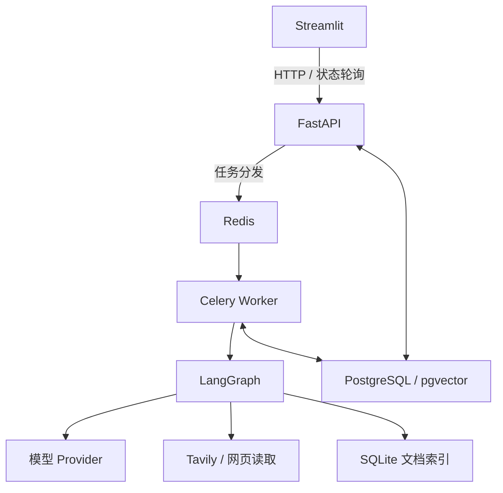

# 多 Agent 研究助手

基于 LangGraph 的研究与知识管理应用，使用 Python 简易界面连接 FastAPI，保留异步任务、文档检索、人工审核、证据引用和项目记忆。

## 功能与流程

- Planner 拆解问题，Executor 调用搜索工具，Critic 评价证据，Synthesizer 合成报告。
- 计划审批后执行研究；草稿可以批准或反馈重写，Checkpoint 支持恢复。
- 文档上传、解析、切块、Embedding 与文档索引。
- 批准报告写入 pgvector 项目记忆，支持带引用的项目问答。
- Markdown、PDF、JSON 工件导出及离线完整性验证。
- 研究状态、工具事件、来源、证据和审批记录可查询。

```text
问题 → Planner → 计划审批 → Executor ⇄ Critic → Synthesizer → 报告审批 → 工件
                                  补充研究                    ↓
                                                     项目记忆与问答
```

## 架构与技术栈



Python 3.14、Streamlit 1.66、FastAPI、Pydantic、LangGraph、LangChain、Celery、Redis、SQLAlchemy、Alembic、PostgreSQL、pgvector、Tavily、Docker Compose。

界面仅调用 API，不直接访问数据库或执行 Agent。生产界面和后端分别运行；不需要 Node.js。

## 目录与阅读顺序

```text
backend/
  app/
    api/v1/          # 研究、项目、文档、审批与问答接口
    services/        # 认证、检索、记忆与配置
    workers/         # Celery 任务与进程内事件循环
    models/          # 业务数据模型
    run_execution.py # 执行与持久化
  research_engine/   # Agent 图、状态、模型、工具与证据
  alembic/           # 数据库迁移
  tests/             # 后端回归
  evals/             # 评测工具与数据集
ui/
  app.py             # 登录、项目、研究、审批、文档与问答
  api_client.py      # 每会话 HTTP 客户端
  state.py           # 状态与重复提交保护
  tests/             # 客户端、界面与隔离服务集成测试
ops/
  start.ps1
  stop.ps1
  test.ps1
  models.py
compose.yml
```

推荐顺序：`ui/app.py` → `ui/api_client.py` → `backend/app/api/v1/runs.py` → `app/workers/tasks.py` → `app/run_execution.py` → `research_engine/runner.py` → `graph.py` 与 `state.py`。随后阅读 `corpus.py`、`app/services/memory.py` 和数据库模型。

## 本地运行

需要 Docker 与 Compose v2。以下命令在项目根目录的 PowerShell 中执行。

已有 `.env` 直接使用。首次安装：

```powershell
if (-not (Test-Path .env)) { Copy-Item .env.example .env }
```

填写 `JWT_SECRET_KEY` 与 `POSTGRES_PASSWORD`。JWT 密钥可通过已有 Python 环境生成：

```powershell
python -c "import secrets; print(secrets.token_hex(32))"
```

模板默认 `LLM_MODE=fake`，使用脚本化模型和本地 Fake Embedding，不会调用付费模型。现有安装的真实模式不会因模板变化而修改。

```powershell
powershell -ExecutionPolicy Bypass -File .\ops\start.ps1
```

访问 **http://localhost:8501**。注册／登录，创建项目，提交问题，审批计划，等待研究后审批报告。文档与项目记忆在单独页面展示。

API 启动时执行 Alembic 迁移。界面每三秒查询运行中的任务；等待审批和终态停止定时查询。刷新浏览器后需重新登录，可选择已有任务继续查看，后台研究不会重跑。

### 真实模型与 Embedding

在本地 `.env` 中配置：
- `LLM_MODE=real`。
- `CUSTOM_BASE_URL=https://api.deepseek.com/v1`、`CUSTOM_API_KEY`。
- 将五个 `MODEL_*` 设置为 `custom:实际可用模型ID`。
- `TAVILY_API_KEY`。
- Google Embedding：`GOOGLE_API_KEY`、`EMBEDDINGS_PROVIDER=google`、`EMBEDDINGS_MODEL=gemini-embedding-001`。
- OpenRouter 备用：`OPENROUTER_API_KEY`、`EMBEDDINGS_PROVIDER=openrouter`、`EMBEDDINGS_MODEL=openai/text-embedding-3-small`。

模型是否可用以账号和供应商实际响应为准。角色独立配置，不自动切换 Provider。模型服务在宿主机时，应显式使用 `host.docker.internal`；系统不再猜测或重写 loopback 地址。

修改配置后：

```powershell
docker compose -f compose.yml up -d api worker
```

上传文档索引与报告记忆分别管理。切换 Embedding 后检查索引模型；报告工作台提供显式记忆摄取重试，已有当前模型索引会跳过。原有语料模式对远程 Embedding 的隐私限制保留，不能将“仅文档检索”理解为任意云 Embedding 都已验证可用。

### 服务与数据

```powershell
docker compose -f compose.yml ps
docker compose -f compose.yml logs -f api worker ui
powershell -ExecutionPolicy Bypass -File .\ops\stop.ps1
```

`POSTGRES_VOLUME`、`REDIS_VOLUME`、`CORPUS_VOLUME` 指定持久化卷。已有安装移动目录时保持这些值及数据库密码不变。停止服务不删除数据，不要对个人研究环境执行 `down -v`。

## 测试

```powershell
powershell -ExecutionPolicy Bypass -File .\ops\test.ps1
```

脚本启动独立 Fake API／Worker／数据库与测试界面，运行定向后端回归和 UI 测试。测试环境清空外部 Provider 凭证，与真实服务及数据卷隔离。测试界面端口为 18501，API 为 18000。

更多后端测试保存在 `backend/tests/`；需要本地模型的真实评测为显式操作。Fake、受控本地 HTTP Provider 和真实云 API 的结果不能混算。

本轮精简版定向验收为后端 300 项、界面与联调 10 项全部通过；另完成一次 DeepSeek 官方推理、Tavily、Google Embedding、双审批、导出和记忆问答的真实验证。
