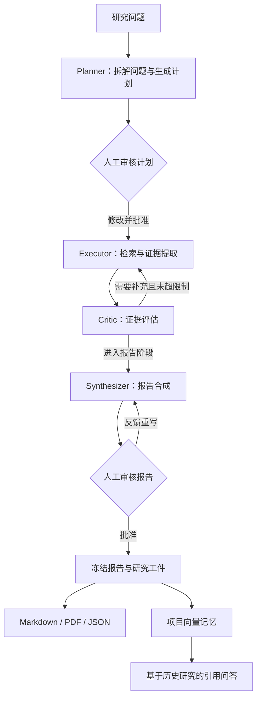
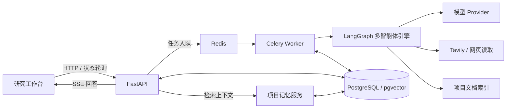

<h1 align="center">ResearchFlow Agents</h1>

<p align="center">
  <strong>多智能体协作，让研究从问题走向可追溯的报告</strong>
</p>

<p align="center">
  任务规划 · 工具调用 · 证据评估 · 人工审核 · 项目记忆
</p>

<p align="center">
  <a href="https://www.python.org/"></a>
  <a href="https://github.com/langchain-ai/langgraph"></a>
  <a href="https://github.com/langchain-ai/langchain"></a>
  <a href="https://fastapi.tiangolo.com/"></a>
  <a href="https://docs.pydantic.dev/"></a>
</p>

<p align="center">
  <a href="https://docs.celeryq.dev/"></a>
  <a href="https://redis.io/"></a>
  <a href="https://www.postgresql.org/"></a>
  <a href="https://github.com/pgvector/pgvector"></a>
  <a href="https://www.docker.com/"></a>
</p>
<p align="center">
  <a href="https://www.tavily.com/"></a>
</p>


## 项目介绍

ResearchFlow Agents 是一个基于 **LangGraph 的多智能体研究系统**。围绕一个研究问题，系统组织 Planner、Executor、Critic 和 Synthesizer 分工协作，完成问题拆解、信息检索、证据评估、补充研究与报告生成，并将人工审核引入计划和报告两个关键阶段。

项目将 Agent 工作流与后端工程结合：使用 FastAPI 提供接口，Celery 执行后台研究，Redis 承担消息分发与缓存，PostgreSQL 保存业务状态，pgvector 支持已批准报告的语义检索。研究结果可以继续进入项目记忆，为后续问答提供上下文与引用来源。

适用于技术调研、方案对比、专题资料整理，以及多智能体、RAG 和异步任务系统的工程实践。

## 核心能力

| 能力 | 实现说明 |
| --- | --- |
| 多智能体协作 | 四类 Agent 通过共享状态、条件路由与工具结果协同完成研究 |
| 计划生成与审核 | 自动拆解研究子任务，允许人工修改、选择和批准计划 |
| 工具调用与网络检索 | Executor 调用搜索、网页读取等工具，Tavily 优先提供网络搜索 |
| 证据评估与补充研究 | Critic 检查研究证据，结合轮次与预算限制决定后续路由 |
| 报告生成与审核 | 根据已有证据生成报告，支持批准或提交反馈要求重写 |
| Checkpoint 与恢复 | 保存 LangGraph 执行状态，在审核后恢复同一研究任务 |
| 文档检索 | 支持文档上传、解析、切块、Embedding 与项目语料索引 |
| 项目记忆与问答 | 已批准报告写入向量记忆，按项目检索并生成带引用的回答 |
| 模型路由 | 不同角色可独立配置模型；推理模型与 Embedding 分开配置 |
| 运行追踪 | 查询任务状态、Agent 事件、工具执行、证据、来源与审核记录 |
| 报告导出 | 导出 Markdown、PDF、JSON 工件，并验证内容完整性和引用关联 |

## 多智能体工作流



### Agent 职责

| Agent | 主要职责 | 配置项 |
| --- | --- | --- |
| Planner | 分析问题，生成可执行的研究任务和报告结构 | `MODEL_PLANNER` |
| Executor | 调用检索工具，读取来源，提取支持研究问题的证据 | `MODEL_EXECUTOR` |
| Critic | 评估证据质量，参与引用核验与矛盾检查，给出研究反馈 | `MODEL_CRITIC` |
| Synthesizer | 整合证据、组织论述、关联引用，并根据审核反馈重写 | `MODEL_SYNTHESIZER` |
| Chat | 根据项目记忆与所选检索范围回答后续问题 | `MODEL_CHAT` |

Agent 通过 `AgentState` 传递任务、证据、评价及报告等状态。LangGraph 管理节点间的流转与条件分支；Pydantic 约束结构化输入输出；Checkpoint 保存执行状态；API 与 Worker 负责将状态变化持久化到业务数据层。

人工审核是工作流的一部分：计划批准后才进入研究执行，报告批准后才形成最终工件。Critic 达到轮次上限后可能使用已有证据进入合成阶段，因此任务完成不代表所有证据评价均已通过。

## 系统架构



| 技术 | 项目中的职责 |
| --- | --- |
| LangGraph / LangChain | Agent 编排、状态流转、模型适配与工具调用 |
| FastAPI / Pydantic | 接口、请求校验、结构化数据契约和 SSE 响应 |
| Celery / Redis | 后台任务执行、消息分发、缓存及限流等支持能力 |
| PostgreSQL / SQLAlchemy / Alembic | 业务数据持久化、数据访问与数据库迁移 |
| pgvector | 项目报告记忆的向量存储与相似度检索 |
| SQLite 文档索引 | 项目文档切块、索引及语料检索 |
| Streamlit | 研究任务、审核、知识库和记忆问答的交互入口 |
| Docker Compose | 统一启动运行环境，隔离业务服务和测试环境 |

交互层只调用 API，不直接操作数据库或运行 Agent。关闭页面不会重新提交研究，也不会终止已交给 Worker 的后台任务。

## 项目结构

```text
researchflow-agents/
├── backend/
│   ├── app/
│   │   ├── api/v1/          # 研究、审核、项目、文档、问答与配置接口
│   │   ├── models/          # 用户、项目、研究任务、证据与审核等数据模型
│   │   ├── services/        # 认证、记忆、检索、导出及配置服务
│   │   ├── workers/         # Celery 任务和任务分发
│   │   └── run_execution.py # 研究执行、状态恢复及结果持久化
│   ├── research_engine/
│   │   ├── graph.py         # Agent 节点、条件路由与图构建
│   │   ├── state.py         # AgentState 定义
│   │   ├── runner.py        # 研究引擎运行入口
│   │   ├── llm_factory.py   # 模型 Provider 工厂
│   │   ├── tools.py         # 搜索与网页读取等工具
│   │   ├── retrievers.py    # 搜索链与缓存
│   │   └── corpus.py        # 文档语料检索
│   ├── alembic/             # 数据库迁移
│   ├── tests/               # 后端测试
│   └── evals/               # 质量、检索等评测工具与数据集
├── ui/
│   ├── app.py               # 研究工作台
│   ├── api_client.py        # 会话独立的 API 客户端
│   ├── state.py             # 状态管理与重复提交保护
│   └── tests/               # 客户端、页面与联调测试
├── ops/                     # 启动、停止、测试及模型切换脚本
├── compose.yml
└── .env.example
```

## 本地运行

### 1. 环境准备

- 安装并启动 Docker，确认 Docker Compose v2 可用。
- 预留本地端口 `8501` 和 `8000`。
- 容器运行时使用 Python 3.14；采用 Docker 启动无需在宿主机安装项目 Python 依赖或 Node.js。
- 下面以 **Windows PowerShell** 为例，所有命令均在项目根目录执行。模型切换脚本需要宿主机具备 Python。

### 2. 创建配置

首次运行复制配置模板；已有 `.env` 时保留原配置：

```powershell
if (-not (Test-Path .env)) {
    Copy-Item .env.example .env
}

notepad .env
```

先填写以下必要项：

| 变量 | 用途 |
| --- | --- |
| `JWT_SECRET_KEY` | 登录令牌签名，使用至少 32 字符的随机密钥 |
| `POSTGRES_PASSWORD` | PostgreSQL 密码，建议使用随机十六进制字符串 |
| `LLM_MODE` | `fake` 为离线流程验证，`real` 为真实模型调用 |
| `MODEL_*` | 五个角色的 `provider:model` 路由 |
| `TAVILY_API_KEY` | 真实网络搜索 |
| `EMBEDDINGS_PROVIDER` / `EMBEDDINGS_MODEL` | 独立选择 Embedding 服务和模型 |

如果宿主机已安装 Python，可以生成随机密钥，再将结果填入本地配置：

```powershell
python -c "import secrets; print(secrets.token_hex(32))"
```

模板默认使用 `LLM_MODE=fake`，通过脚本化模型、模拟搜索与 Fake Embedding 验证工作流，不调用付费模型。真实研究需要按下一节填写供应商凭证并显式启用 `real`。

`.env` 已被 Git 忽略；仓库仅提交空密钥模板 `.env.example`。

### 3. 启动服务

```powershell
powershell -ExecutionPolicy Bypass -File .\ops\start.ps1
```

也可以直接使用 Compose：

```powershell
docker compose -f compose.yml up -d --build
```

API 启动时执行 Alembic 迁移；数据库与 Redis 就绪后，再启动依赖它们的服务。

| 入口 | 地址 |
| --- | --- |
| 研究工作台 | [http://localhost:8501](http://localhost:8501) |
| API 就绪检查 | [http://localhost:8000/health/ready](http://localhost:8000/health/ready) |
| API 交互文档 | [http://localhost:8000/docs](http://localhost:8000/docs)，开发环境提供 |

### 4. 完成一次研究

1. 注册并登录本地账号，创建一个研究项目。
2. 提交研究问题，选择研究深度与检索范围。
3. 等待 Planner 生成计划，按需修改子任务并批准。
4. 查看 Executor 检索、Critic 评价及后续报告生成的运行记录。
5. 审核报告：批准形成最终工件，或提交反馈要求重写。
6. 导出报告，在项目记忆页检查索引状态，并基于批准报告继续问答。

示例研究问题：

> 比较 LangGraph、CrewAI 与 AutoGen 的状态管理和人工介入机制，说明适用场景，并提供可追溯的来源引用。

可先用 Fake 模式熟悉审批流程，再以少量任务验证真实模型。示例问题本身不代表已完成统一评测。

## 模型与 Embedding 配置

### 推理模型

各角色独立读取模型配置。下面是 DeepSeek 官方 OpenAI-compatible 通道的配置示例，所有占位符均须替换：

```dotenv
LLM_MODE=real
CUSTOM_BASE_URL=https://api.deepseek.com/v1
CUSTOM_API_KEY=<your-deepseek-api-key>

MODEL_PLANNER=custom:deepseek-flash
MODEL_EXECUTOR=custom:deepseek-flash
MODEL_CRITIC=custom:deepseek-flash
MODEL_SYNTHESIZER=custom:deepseek-flash
MODEL_CHAT=custom:deepseek-flash

TAVILY_API_KEY=<your-tavily-api-key>
```

`deepseek-flash` 为本项目真实联调使用的模型 ID；可用性以供应商当前接口和账号权限为准。同一模型可以服务多个角色，也可以分别配置不同模型，Agent 职责由工作流与提示词定义。

Google 官方推理通道通过 `google:模型ID` 路由并读取 `GOOGLE_API_KEY`。模型切换脚本提供 Google 与 DeepSeek 配置方案，**不会自动探测配额或在调用失败后切换到其他 Provider**。

如使用切换脚本，先在 `.env` 填写对应密钥；DeepSeek 方案读取 `DEEPSEEK_API_KEY`，并写入 Custom Provider 所需配置：

```powershell
# 查看当前配置，不显示密钥
python .\ops\models.py status

# 选择一个方案
python .\ops\models.py deepseek
# python .\ops\models.py google

# 重新创建读取配置的服务
docker compose -f compose.yml up -d api worker
```

新配置主要作用于新研究任务。已有任务保存了模型与执行配置快照，不应通过直接修改快照来强行更换中途使用的模型。

### Embedding 与索引

推理模型与 Embedding 独立配置。例如使用 DeepSeek 推理、Google Embedding：

```dotenv
GOOGLE_API_KEY=<your-google-api-key>
EMBEDDINGS_PROVIDER=google
EMBEDDINGS_MODEL=gemini-embedding-001
```

也提供 OpenRouter Embedding 配置入口：

```dotenv
OPENROUTER_API_KEY=<your-openrouter-api-key>
EMBEDDINGS_PROVIDER=openrouter
EMBEDDINGS_MODEL=openai/text-embedding-3-small
```

切换后需检查当前模型的索引状态，不同模型的向量不能作为同一语义空间混用。已批准报告可在工作台显式补建当前模型的记忆索引；文档索引与报告记忆分别管理。

文档上传、报告记忆和仅文档研究是不同路径。仅文档研究保留远程 Embedding 的隐私限制，不能将云端文档索引成功理解为所有 corpus-only 配置均可直接运行。

### 运行预算

使用 `.env` 中的限制项约束研究规模：

| 配置项 | 作用 |
| --- | --- |
| `MAX_PARALLEL_TASKS` | 研究子任务并发上限 |
| `MAX_CRITIC_LOOPS` | Critic 补充研究循环上限 |
| `MAX_INPUT_TOKENS` | 输入 Token 保护阈值 |
| `MAX_WALLCLOCK_SECONDS` | 工作流执行时长保护阈值 |
| `MAX_COST_PER_SESSION_USD` | 已计价模型的研究费用保护阈值 |

首次真实运行建议保持并发为 1，并使用少量子任务。Token 和费用检查发生在工作流节点边界；Custom Provider 的费用可能未计价，因此 `cost=0` 不代表免费，这些配置也不等于供应商账单的硬上限。

## 日常维护

```powershell
# 查看服务状态
docker compose -f compose.yml ps

# 查看运行日志，按 Ctrl+C 退出日志跟踪
docker compose -f compose.yml logs -f api worker ui

# 重启业务服务
docker compose -f compose.yml restart api worker ui

# 代码修改后重新构建并启动
docker compose -f compose.yml up -d --build

# 停止服务，保留持久化数据
powershell -ExecutionPolicy Bypass -File .\ops\stop.ps1
```

数据库、Redis 与文档数据分别通过 `POSTGRES_VOLUME`、`REDIS_VOLUME`、`CORPUS_VOLUME` 指定持久化卷。迁移已有安装时保持卷名及数据库凭证一致；不要使用 `down -v` 清理需要保留的研究数据。

## 测试与验证

运行定向回归：

```powershell
powershell -ExecutionPolicy Bypass -File .\ops\test.ps1
```

测试脚本启动独立的 API、Worker、PostgreSQL、Redis 与交互服务，使用 Fake 模式并清空外部 Provider 凭证。测试服务与真实研究环境隔离，测试入口分别为 `18000` 和 `18501`。

截至 2026-11-02，当前版本已执行的验证包括：

| 类别 | 结果与范围 |
| --- | --- |
| 后端定向回归 | **300 项通过**：研究 API、模型路由、工作流、审核恢复、记忆、上传、引用、指标、权限与 SSRF 等 |
| 客户端与交互联调 | **10 项通过**：会话隔离、鉴权刷新、重复提交保护、SSE、页面渲染及服务集成 |
| 小规模真实联调 | DeepSeek 官方推理、Tavily 搜索、Google Embedding、计划与报告审批、三种格式导出、项目记忆问答 |
| 工件验证 | 一次真实任务的 7 项完整性与引用关联检查通过 |

自动化测试主要使用 Fake 或受控测试 Provider，不能等同于真实模型效果评测。真实联调为单次小规模工程验证，不能据此推导任务总体完成率、P95 延迟或研究准确率。报告可能提示证据不足；工件完整性与引用关联检查不替代事实核验。

后端保留更多测试与评测工具；上述数量仅对应已执行的定向验收，不代表全部测试均已运行。定向测试的具体文件列表与执行顺序见 [`ops/test.ps1`](ops/test.ps1)。
